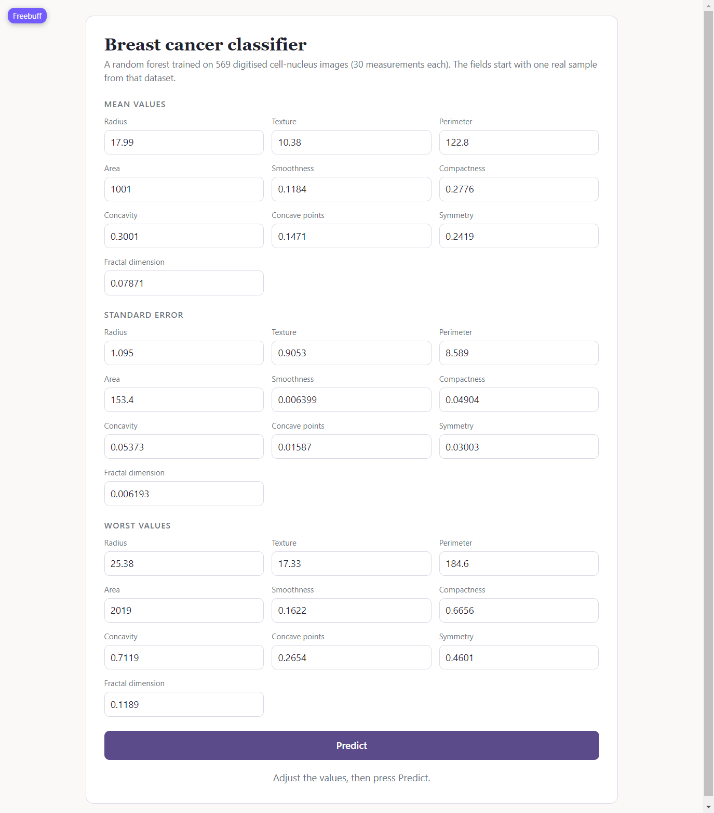
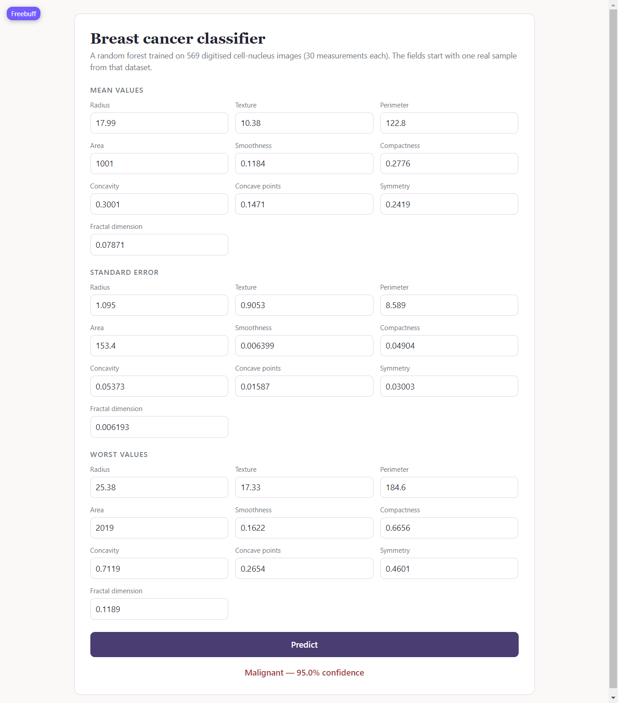

# InferOps — Breast cancer classifier with a CI/CD pipeline

[](https://github.com/Dhruv-Kashyap-3009/InferOps/actions/workflows/ci-cd.yml)

A small "MLOps in miniature" project: a scikit-learn classifier that predicts whether a
breast tumour is **malignant** or **benign**, served by FastAPI, with a one-page web form,
containerized with Docker, and shipped to Render by GitHub Actions.

## What it does

- Trains a `RandomForestClassifier` (200 trees) on the Breast Cancer Wisconsin dataset:
  569 samples, 30 measurements per sample, about 95% accuracy on held-out data.
- Serves three routes with FastAPI: `GET /` (the form), `GET /health`, `POST /predict`.
- Returns `{"prediction": "malignant", "confidence": 0.95}` (or `"benign"`).
- Rejects negative, missing or non-numeric measurements with HTTP 422.

## How it fits together

```
              git push / pull request
                       │
                       ▼
              ┌──────────────────┐
              │  GitHub Actions  │
              │  job: test       │   flake8 → train model → pytest
              └────────┬─────────┘
                       │ only on push to main
                       ▼
              ┌──────────────────┐
              │  job: docker     │   build image → push to Docker Hub → Trivy scan
              └────────┬─────────┘
                       ▼
              ┌──────────────────┐
              │  job: deploy     │   curl the Render deploy hook
              └────────┬─────────┘
                       ▼
        ┌───────────────────────┐        ┌──────────────────────┐
        │        Render         │ pulls  │      Docker Hub      │
        │    web service        │◄───────│ inferops-api:latest  │
        └───────────┬───────────┘        └──────────────────────┘
                    ▼
        FastAPI:  /   ·   /health   ·   /predict
                    │
                    ▼
        Browser form (plain HTML + fetch)
```

## Screenshots

The form at `GET /`:



After pressing Predict with a malignant sample:



## Run it locally

PowerShell:

```powershell
cd InferOps
python -m venv .venv
.\.venv\Scripts\Activate.ps1
pip install -r requirements.txt
python model\train.py
uvicorn app.main:app --reload
```

Command Prompt differs only in the activation line: `.\.venv\Scripts\activate.bat`.

Open <http://127.0.0.1:8000/> and press **Predict**. The API docs live at
<http://127.0.0.1:8000/docs>.

If PowerShell blocks the activation script, run this once in the same terminal:

```powershell
Set-ExecutionPolicy -Scope Process -ExecutionPolicy RemoteSigned
```

## Call the API

All 30 measurements are required. The values below are one real malignant sample:

```bash
curl -X POST http://127.0.0.1:8000/predict \
  -H "Content-Type: application/json" \
  -d '{"mean_radius":17.99,"mean_texture":10.38,"mean_perimeter":122.8,
       "mean_area":1001.0,"mean_smoothness":0.1184,"mean_compactness":0.2776,
       "mean_concavity":0.3001,"mean_concave_points":0.1471,"mean_symmetry":0.2419,
       "mean_fractal_dimension":0.07871,"radius_error":1.095,"texture_error":0.9053,
       "perimeter_error":8.589,"area_error":153.4,"smoothness_error":0.006399,
       "compactness_error":0.04904,"concavity_error":0.05373,
       "concave_points_error":0.01587,"symmetry_error":0.03003,
       "fractal_dimension_error":0.006193,"worst_radius":25.38,"worst_texture":17.33,
       "worst_perimeter":184.6,"worst_area":2019.0,"worst_smoothness":0.1622,
       "worst_compactness":0.6656,"worst_concavity":0.7119,
       "worst_concave_points":0.2654,"worst_symmetry":0.4601,
       "worst_fractal_dimension":0.1189}'
```

```json
{"prediction": "malignant", "confidence": 0.95}
```

On PowerShell 5, `curl` is an alias for `Invoke-WebRequest` — use `curl.exe` instead.
The same request works against the deployed Render URL.

## Tests and linting

```powershell
python -m pytest -q
flake8 --max-line-length=88 app tests
```

Four tests cover the health route, a valid prediction, invalid input (422), and the home page.

## Docker

```powershell
docker build -t inferops-api .
docker run --rm -p 8000:8000 inferops-api
```

The trained model is **not** committed to git; both the image build and the CI test job
recreate it with `python model/train.py`. The container reads the `PORT` environment
variable (default `8000`), which is how Render chooses its port.

## Pipeline and secrets

| Job | Runs on | What it does |
|---|---|---|
| `test` | every push and pull request | flake8, train the model, pytest |
| `docker` | pushes to `main` only | build, push to Docker Hub, Trivy scan |
| `deploy` | after a successful `docker` job | calls the Render deploy hook |

Required repository secrets (Settings → Secrets and variables → Actions):

| Secret | Value |
|---|---|
| `DOCKERHUB_USERNAME` | Docker Hub username |
| `DOCKERHUB_TOKEN` | Docker Hub access token (Read & Write) |
| `RENDER_DEPLOY_HOOK` | Render service deploy hook URL |

Render is configured as a **Web Service from an existing image**:
`docker.io/<dockerhub-username>/inferops-api:latest`. Every push to `main` publishes a new
image and triggers a redeploy.

## Project structure

```
InferOps/
├── app/
│   ├── __init__.py
│   ├── main.py              # 3 routes + the 30-field input schema
│   └── static/index.html    # 30-input form, inline style/script
├── model/train.py           # trains and saves model/breast_cancer.joblib
├── tests/test_api.py        # 4 pytest tests
├── docs/                    # screenshots used by this README
├── .github/workflows/ci-cd.yml
├── Dockerfile
├── .dockerignore
├── .gitignore
├── requirements.txt
└── README.md
```
